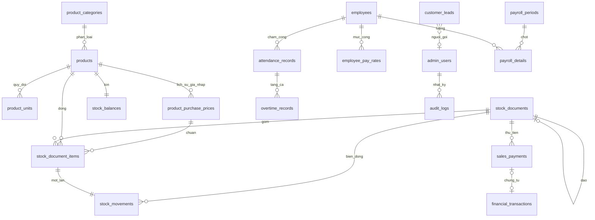

# Sơ đồ dữ liệu

Migration phát hành đầu là `backend/src/main/resources/db/migration/V1__init_schema.sql`. File này đã gồm cấp số phiếu, một đơn vị cơ sở, chống ghi trùng, đảo phiếu một lần, cấu hình chấm công và các chỉ mục báo cáo.

Quy tắc không thể hiện hết bằng khóa ngoại, ví dụ phiếu bán phải có người nhận, được kiểm tra ở tầng nghiệp vụ khi làm module kho.

`product_purchase_prices` giữ lịch sử giá nhập theo khoảng hiệu lực (`effective_from`, `effective_to`). Nhiều mốc có thể cùng một ngày khi Admin đổi giá trong ngày mà mốc cũ đã dùng trên phiếu; mốc có `id` lớn hơn là mốc được áp dụng. Mỗi dòng phiếu trỏ `purchase_price_id` và lưu `standard_cost_per_base_snapshot` / `standard_cost_total_snapshot`, nên sửa giá về sau không làm đổi chi phí chuẩn của phiếu đã xác nhận.

`customer_leads` nhận thông tin khách điền trên landing page công khai. Bảng này tách hẳn khỏi dữ liệu kinh doanh: chỉ Admin đăng nhập mới đọc được, và không có khóa ngoại nào từ bảng nghiệp vụ trỏ sang.
