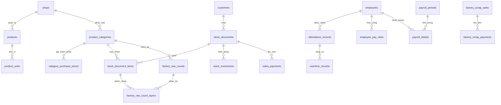

# Sơ đồ dữ liệu

Schema được quản lý bằng Flyway trong `backend/src/main/resources/db/migration`; kiểm tra toàn bộ migration theo thứ tự, hiện có đến V31. Sơ đồ dưới đây là quan hệ nghiệp vụ chính, không thay thế định nghĩa khóa và ràng buộc trong migration.

`stock_balances` theo cặp sản phẩm và loại nhôm; phân phối dùng biến động tồn, còn phiếu bán xưởng mới không tạo biến động tồn. `category_purchase_prices` lưu giá nhập tham khảo theo loại, không thay thế giá thực tế của phiếu nhập.

V23 bỏ khóa duy nhất `(category_id, effective_from)` của `category_purchase_prices` để giữ các lần đổi giá khác nhau trong cùng ngày; truy vấn giá theo ngày chọn mốc có ID mới nhất.

V20 tạo phiếu và thanh toán phế liệu, kiểm kê tổng theo năm. V21 thêm mã chống ghi trùng phế liệu. V22 thêm giá nhập tham chiếu cho dòng bán xưởng và bảng `factory_raw_counts`, `factory_raw_count_layers` lưu số kg theo loại cùng phân bổ vào các dòng nhập. Nếu lịch sử phiếu nhập không đủ kg, chức năng hiện báo lỗi; chưa có bảng nhập lớp tồn đầu kỳ theo loại riêng.

V24 lưu mức thưởng trên ngày lễ, trạng thái nhận theo từng nhân viên và khoản thưởng lễ đã cộng trong bảng lương.

V25 bổ sung phiếu chi cho các khoản thưởng lễ đã nhận. Phiếu chi gắn với ngày lễ và có khóa theo cặp ngày lễ, nhân viên.

V26 lưu mã phiên đăng nhập đã thu hồi. V27 thêm số tiền lương đã ứng, số giờ tăng ca đã duyệt và thưởng lễ đã nhận vào chi tiết kỳ tiền công.
V31 thêm `year_end_balances` (khóa `shop_id, year_number`) lưu bản chụp kg/giá trị tồn, nợ khách, nợ nhà cung cấp, lãi và thời điểm chốt. Phiếu và thanh toán gốc không bị chuyển hoặc nhân bản; các số dư vẫn được theo dõi liên tục qua năm.

V32 thêm `period_from`, `period_to` vào `year_end_balances` và `factory_year_counts`. Các bản cũ được gán 01/01–31/12 của `year_number` khi nâng cấp; dữ liệu phiếu và thanh toán không đổi. Các bản mới dùng ngày chốt do cửa hàng chọn.
